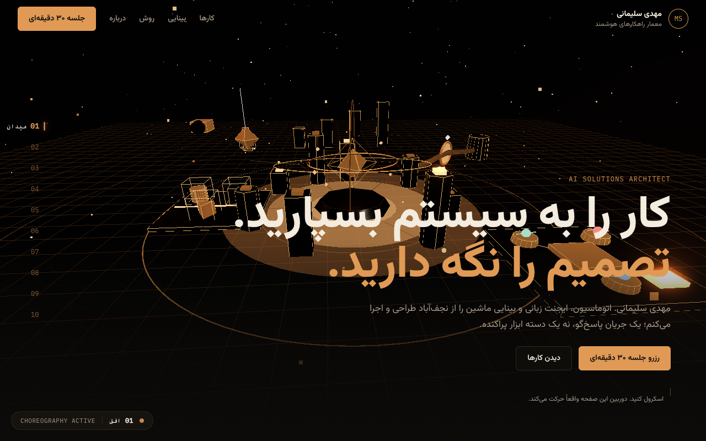
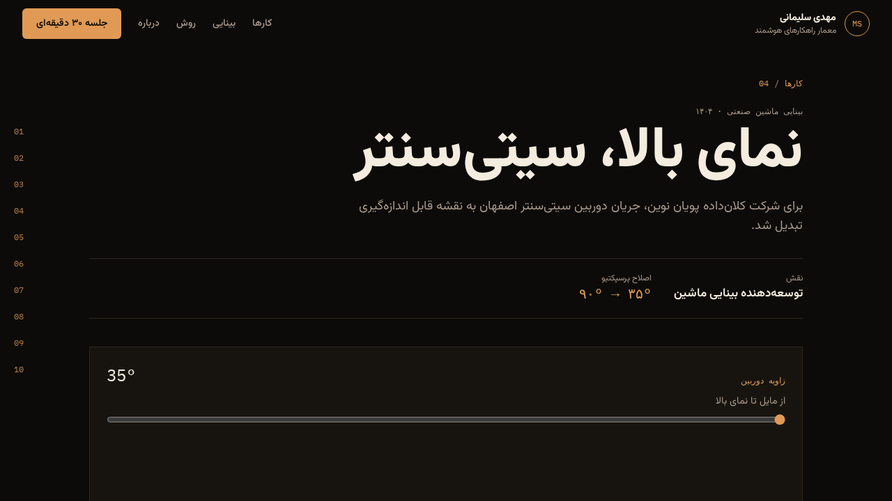
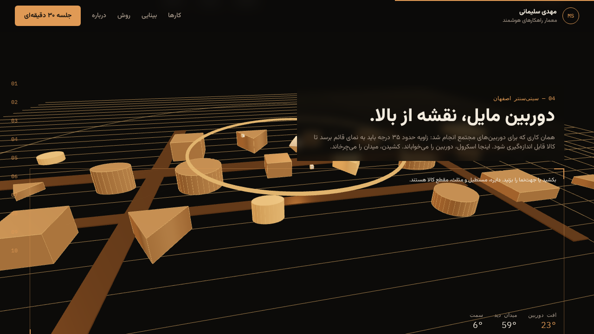
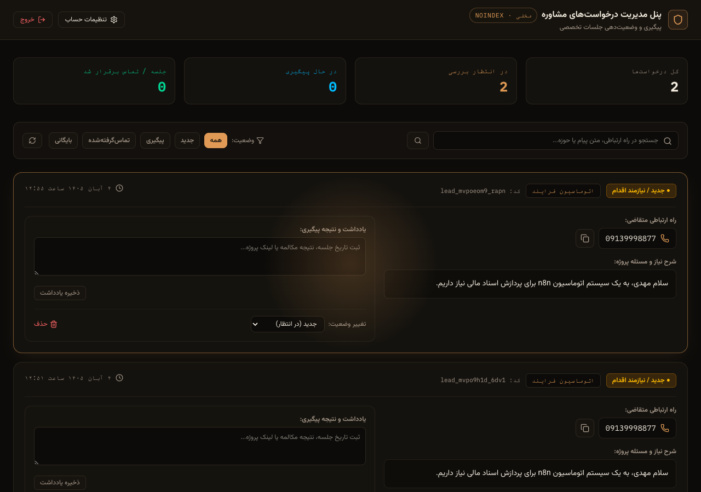
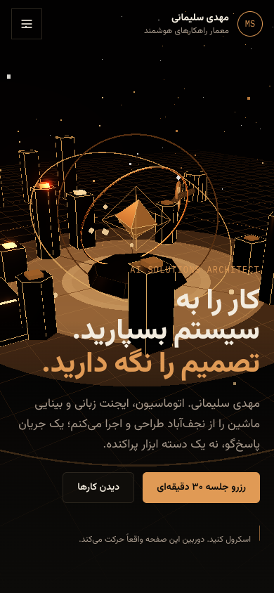

# Mahdi Soleimani — 3D Personal Brand & AI Solutions Platform

[**نسخه فارسی مستندات (Persian README)**](./README.fa.md)


[](https://3d-personal-site-five.vercel.app/)

> 🚀 **Live Production Demo:** [https://3d-personal-site-five.vercel.app/](https://3d-personal-site-five.vercel.app/)

An immersive, high-performance personal branding website and interactive 3D showcase built with **React 19**, **Three.js**, **TanStack Start**, and **Tailwind CSS v4**. Featuring continuous camera choreographies tied to scroll narrative, bespoke shaders, mouse-driven parallax, and an unlisted, secure consultation management system.

---

## 📸 Visual Showcase

<div align="center">
  
</div>

<br />

| 3D Narrative Camera & Orbit | AI Ecosystem Showcase |
| :---: | :---: |
|  |  |

| Stealth Consultation Admin Panel | Mobile-First Responsive Design |
| :---: | :---: |
|  |  |

---

## ✨ Key Features

### 1. 3D Narrative & Visual Choreography
- **Continuous Three.js Camera Banking:** Smooth interpolation and camera roll/pitch tied directly to the user's scroll position across 10 distinct narrative chapters.
- **Mouse & Pointer Parallax:** Responsive real-time scene offset that reacts dynamically to cursor motion.
- **Procedural Floor & Mesh Waves:** Wave motion and wireframe grids powered by custom vertex shaders and procedural geometry.
- **Glassmorphic & Spotlight UI:** Designed with inspiration from [motionsites.ai](https://motionsites.ai/) and [21st.dev](https://21st.dev/), featuring border-beam effects, radial spotlights, and an obsidian & copper color palette (`#0c0b09` / `#e09a55`).

### 2. Stealth Consultation Management Panel
- **Unlisted & Isolated (`/admin`):** Fully excluded from search indexing with `robots.txt` disallowing `/admin` and meta tags (`noindex, nofollow, noarchive`).
- **Encrypted & Hashed Credentials:** Password and username are hashed with **PBKDF2-SHA256 (100,000 rounds)** and random cryptographic salts; never stored in plaintext.
- **Real-Time Request Tracking:** Filter, search, update status (`new`, `in_progress`, `contacted`, `closed`), and record internal meeting notes per lead.
- **In-Panel Credential Settings:** Change username and password securely from within the dashboard.

### 3. Modern Full-Stack Architecture
- **Dual-Engine PostgreSQL:** Zero-setup embedded **PGLite** (WebAssembly Postgres) for local development and instant preview, with seamless one-variable transition to **Neon PostgreSQL** in production.
- **Server Functions (`createServerFn`):** Secure server-side query execution and session token validation with complete client-side data isolation.

---

## 🛠 Tech Stack

| Layer | Technology |
| :--- | :--- |
| **Framework** | [TanStack Start](https://tanstack.com/start) v1.168 / [Vite](https://vitejs.dev/) v8.2 / [Nitro](https://nitro.unjs.io/) v3 |
| **UI Library** | [React 19](https://react.dev/) (`react` & `react-dom` 19.2) |
| **Language** | [TypeScript](https://www.typescriptlang.org/) 5.7 |
| **3D Engine** | [Three.js](https://threejs.org/) r186 (WebGL, Orbit Controls, Custom Shaders) |
| **Styling** | [Tailwind CSS v4](https://tailwindcss.com/) + Radix UI Primitives + Lucide Icons |
| **State Management** | [Zustand](https://github.com/pmndrs/zustand) v5 |
| **Database** | PostgreSQL ([PGLite](https://pglite.dev/) for local dev / [Neon](https://neon.tech/) for production) |
| **Security** | Node `crypto` PBKDF2-SHA256, Secure Sessions, Input Sanitization |

---

## 📂 Project Architecture

```text
3d-personal-site/
├── .github/
│   ├── workflows/ci.yml           # Automated CI/CD pipeline (Lint, Typecheck, Test, Build)
│   ├── dependabot.yml             # Automated dependency updates
│   ├── ISSUE_TEMPLATE/            # Standardized bug & feature templates
│   └── pull_request_template.md   # PR guidelines checklist
├── assets/
│   ├── banner.png                 # Main repository header banner
│   ├── social-preview.png         # GitHub social preview card (1280x640)
│   └── screenshots/               # High-resolution showcase screenshots
├── migrations/
│   ├── 0001_initial.sql           # Base database schema
│   └── 0002_consultation_admin.sql# Consultation requests & hashed admin credentials
├── public/
│   └── robots.txt                 # Disallows /admin from search engines
├── src/
│   ├── components/
│   │   ├── observatory.tsx        # Core Three.js canvas & camera choreography
│   │   ├── home-film.tsx          # Interactive narrative sections & 21st.dev spotlight cards
│   │   ├── site-chrome.tsx        # Navigation header, progress indicator, chapter rail
│   │   └── ui/                    # Reusable Radix & Tailwind UI primitives
│   ├── lib/
│   │   ├── admin-service.ts       # PBKDF2 hashing, session tokens, consultation server functions
│   │   ├── contact-service.ts     # Consultation form submission server function
│   │   └── db.ts                  # Server-only dual Postgres connection pool (PGLite / Neon)
│   ├── routes/
│   │   ├── index.tsx              # Public 3D interactive portfolio & consultation form
│   │   └── admin.tsx              # Stealth admin panel (noindex, password protected)
│   ├── routeTree.gen.ts           # TanStack Router generated route tree
│   ├── router.tsx                 # Router instance & error boundaries
│   └── styles.css                 # Theme tokens, font imports & Tailwind directives
├── test/
│   └── unit/services.test.mjs     # Automated unit & integration tests
├── .env.example                   # Environment configuration template
├── package.json                   # Dependencies and npm scripts
├── tsconfig.json                  # TypeScript compiler settings
├── vercel.json                    # Vercel deployment build & install configuration
└── vite.config.ts                 # Vite, Nitro, and Tailwind configuration
```

---

## 🚀 Quick Start

### Prerequisites
- **Node.js:** v20.x or v22.x LTS
- **npm:** v10.x+

### 1. Clone & Install
```bash
git clone https://github.com/Mahdi-Soleimani/3d-personal-site.git
cd 3d-personal-site
npm ci
```

### 2. Configure Environment (Optional)
```bash
cp .env.example .env
```
> **Note:** If `DATABASE_URL` is omitted, the application automatically boots an embedded WASM PostgreSQL database (`PGLite`). No local database installation is needed!

### 3. Run Development Server
```bash
npm run dev
```
Open [http://localhost:8080](http://localhost:8080) in your browser.

---

## 🧪 Quality Assurance & Testing

All verification checks can be run locally:

```bash
# Static type checking
npm run typecheck

# Code formatting and ESLint
npm run lint

# Automated unit & integration tests
npm run test

# Production build verification
npm run build
```

---

## 🌐 Free Deployment (Vercel)

This application is pre-configured with Nitro's Vercel Serverless preset (`nitro({ preset: 'vercel' })` in `vite.config.ts` and `vercel.json`).

### Step-by-Step Vercel Deployment:
1. Push this repository to your GitHub account:
   ```bash
   git push -u origin main
   ```
2. Go to [Vercel](https://vercel.com/) and click **Add New Project**.
3. Import the `3d-personal-site` repository.
4. **Framework Preset:** Select *Other* (or Vite).
5. **Environment Variables:**
   - *(Optional)* Add `DATABASE_URL` pointing to a free serverless PostgreSQL instance (e.g., [Neon.tech](https://neon.tech)).
6. Click **Deploy**. Vercel will build and serve the application globally with serverless function support.

---

## 🔒 Security & Privacy

- **No Plaintext Passwords:** PBKDF2-SHA256 with 100,000 iterations and unique cryptographic salts.
- **Search Engine Stealth:** Multiple layers (`robots.txt`, `meta[name="robots"]`, `meta[name="googlebot"]`) guarantee zero indexing of `/admin`.
- **Server Isolation:** Database connections are strictly server-only (`@/lib/db`), preventing any client-side exposure.

For vulnerability reports, please review our [Security Policy](./SECURITY.md).

---

## 📄 License

This project is licensed under the [MIT License](./LICENSE) — see the LICENSE file for details.

Developed with passion by **Mahdi Soleimani**.
